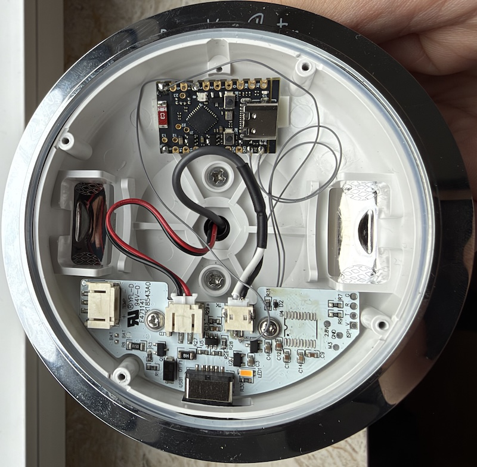
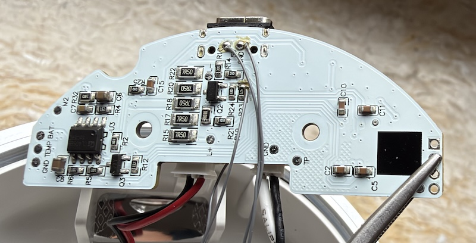

<p align="center">
  
</p>

<h1 align="center">espANTHELLA</h1>

<p align="center">
  <strong>A classic silhouette. A connected light.</strong><br>
  DIY Matter firmware for the Louis Poulsen Panthella 160 Portable.
</p>

<p align="center">
  <a href="https://platformio.org/"></a>
  
  <a href="https://github.com/espressif/esp-matter"></a>
</p>

<p align="center">
  <a href="#the-light">The light</a> &nbsp;·&nbsp;
  <a href="#getting-started">Getting started</a> &nbsp;·&nbsp;
  <a href="#hardware-modification">Hardware modification</a> &nbsp;·&nbsp;
  <a href="#web-dashboard">Dashboard</a>
</p>

---

## The light

**espANTHELLA** brings local smart-home control to a **Louis Poulsen Panthella 160 Portable** using an ESP32 and a suitable interface to the lamp's LED driver. It exposes a Matter dimmable light: switch it on, adjust the brightness, and include it in scenes and automations from your preferred Matter ecosystem.

Built with the Arduino-ESP32 Matter library on top of [Espressif's ESP-Matter](https://github.com/espressif/esp-matter), it combines smart-home integration with a small, self-contained web dashboard. No project-specific cloud service is required.

- **Matter on/off and dimming** over Wi-Fi.
- **Smooth light output** with a compile-time gamma curve, 10-bit PWM, and short hardware fades.
- **Local controls** through the BOOT button and touch-handling code.
- **Browser control** with an on/off switch and brightness slider, synchronized with external changes.
- **Wi-Fi setup portal**—no network credentials compiled into the firmware.
- **Persistent state** for the last on/off setting and brightness.
- **Maintenance tools** for pairing, resets, and firmware uploads.

> [!NOTE]
> This is an independent DIY modification, not an official Louis Poulsen product or a claim of Matter certification. Hardware revisions can differ; the firmware alone does not make a stock lamp compatible.

### Smart-home compatibility

| Platform | Status |
| --- | --- |
| **ESP32-C6 SuperMini** | Tested hardware target; current default build. |
| **IKEA DIRIGERA** | Tested pairing with the IKEA Home smart ecosystem. |
| **Amazon Alexa** | Expected to work through a compatible Matter controller; not separately verified here. |
| **Apple Home / Google Home / other Matter controllers** | Expected to work with Matter dimmable-light support; controller-specific commissioning requirements apply. |

The tested IKEA hub is **DIRIGERA**, not the older **TRÅDFRI gateway**, which does not support direct Matter device pairing. See [IKEA's gateway and app support](https://www.ikea.com/jp/en/customer-service/product-support/app-gateway/).

This firmware uses **Matter over Wi-Fi**, not Zigbee or Matter over Thread. The C6's radio capabilities do not change the transport selected by this project. Use a 2.4 GHz Wi-Fi network; a Thread border router is not required for this firmware. Voice assistants may require their own account, hub, or cloud services.

## Getting started

### Requirements

- An **ESP32-C6 SuperMini** with 4 MB flash and a USB data cable.
- **[PlatformIO](https://platformio.org/install)**—either PlatformIO IDE for VS Code or PlatformIO Core (`pio`).
- A 2.4 GHz Wi-Fi network.
- A Matter controller for smart-home pairing, or a browser for standalone local control.
- For the lamp retrofit: appropriate tools, a verified power supply, and an interface suitable for the lamp's LED driver.

The repository includes its custom [ESP32-C6 board definition](boards/esp32-c6-supermini.json). Build settings live in [platformio.ini](platformio.ini); GPIO assignments and dimming parameters live in [include/config.h](include/config.h).

### 1 · Build and flash over USB

Open this repository in PlatformIO, connect the board, and run these commands from the project root:

```sh
# Compile the default ESP32-C6 environment.
pio run -e default

# Build/upload the LittleFS web assets, then upload the firmware.
pio run -e default -t upload

# Open the serial monitor.
pio device monitor -b 115200
```

The upload hook automatically handles the LittleFS image containing the dashboard, setup pages, styles, and QR-code library. If port detection is ambiguous, use `pio device list` and configure the serial port in PlatformIO.

> [!TIP]
> Keep USB recovery accessible while developing the retrofit. GPIO12 and GPIO13 are USB D− and D+ on the C6: reconfiguring either as a general-purpose output can make the USB serial port disappear.

### 2 · Connect to Wi-Fi

1. On first boot, join the device's **`espANTHELLA-XXXX`** Wi-Fi access point. The suffix is generated from the device MAC address.
2. Open **http://192.168.4.1/** if the captive portal does not appear automatically.
3. Select your Wi-Fi network, or enter its SSID manually, and save the password.
4. The device saves the credentials and reboots onto your network.
5. Open **`http://espanthella-xxxx.local/`**, using your device's suffix, or the IP address printed on the serial monitor.

The setup AP is open by default. Provision the device in a trusted environment. If saved credentials fail, the firmware returns to setup mode.

### 3 · Pair with Matter

Open the dashboard while the device is uncommissioned. In your Matter controller's app, add a device and scan the displayed **QR code**, or enter the **manual pairing code**. The manual code is also printed to serial.

After commissioning, the lamp appears as a dimmable light. Keep the controller and device on a network that allows local discovery and IPv6 traffic; guest/client isolation can prevent pairing or control.

## Hardware modification

### ESP32-C6 SuperMini pin assignment

These are **GPIO numbers**, not connector positions. The current assignments are defined in [include/config.h](include/config.h).

| Signal | C6 GPIO / connection | Purpose |
| --- | --- | --- |
| `PIN_PWM` | **GPIO7** | 3.3 V PWM control signal to a suitable LED-driver interface. |
| `PIN_BUTTON` | **GPIO9** | Onboard BOOT button, active low. |
| `PIN_TOUCH` | **GPIO4 / ADC1_CH4** | Experimental ADC-based touch-pad sensing. |
| Ground | **GND** | Common reference with the lamp's low-voltage control circuit. |
| Board power | Appropriate **5V/VBUS** or regulated **3V3** input | Verify the exact board revision and supply arrangement before connecting. |
| USB | **GPIO12 / GPIO13** | Reserved for USB D− / D+ while USB is in use. |
| Optional RGB debug output | **GPIO8** on the selected board variant | Keep separate from the PWM output. |

**Board reference:** [ESP32-C6 SuperMini high-resolution pinout, datasheet, schematic and specifications — Mischianti](https://mischianti.org/esp32-c6-supermini-high-resolution-pinout-datasheet-schema-and-specs/).

GPIO8 is also assigned to the RGB LED by the generic C6 variant. Enabling the optional `RGB_VERBOSE` code while using GPIO8 for PWM would let the RGB/RMT driver take over the PWM pin. The current PWM assignment uses GPIO7 to avoid that conflict.

GPIO4 and GPIO9 have boot-strapping functions on the C6. External circuits must not force an unsuitable level during reset. GPIO9 held low at reset can enter the ROM download mode rather than start the application.

### Steps to retrofit the Panthella 160 Portable

##### Disassembly
- Open the device, there are four screws below the rubber that you can lift with a thin piece of metal or a knife
- Remove the battery, it's not glued and has a JST-style connector
- Unplug the cables for LED and touch sensor
- Unscrew two screws to remove the PCB. Be careful not to lose the gaskets for the USB-C port.
##### Modification
- If you use a cheap ESP32-C6 super micro board, remove the charhing LED *and* the RGB LED (it consumes power even when off) and the battery charger chip. This works nicely with solder pliers or hot air.
- On the *Panthella PCB*, unsolder the microcontroller (U4). Use hot air at 450°C and flux, it will take ~3-5 sec.
##### Connections
- Use 4 thin wires, about 5cm, described from Panthella to ESP32-C6:
  - Bottom Pad GND -> GND
  - Bottom Pad +5V -> +5V
  - Bottom, R23, right side (towards USB–C port) -> Pin 7
  - Top, left pin (towards USB–C port) of the touch sensor connector -> Pin 4
##### Mount
- Using two ~ 5x5mm thick double sided adhesive tape, stick the ESP32-C6 PCB to the available pads

##### Final Result

| Top view | Bottom view |
| :---: | :---: |
|  |  |

### Touch sensing on the C6

The ESP32-C6 has **no native capacitive-touch peripheral**. The current fallback charges GPIO4, releases it to an input, and samples it with the ADC. It calibrates at startup and uses the measured value for brightness-step detection.

This is **experimental**, not equivalent to a dedicated touch controller. Pad geometry, leakage, ADC behavior, grounding, and the lamp enclosure can change the readings and even their direction. The current C6 detection condition checks for a drop below its derived threshold; validate actual untouched/touched readings before tuning. Keep the pad untouched during calibration. Samples, delay, and threshold multiplier are configured in [include/config.h](include/config.h).

Native-touch targets use the separate `SOC_TOUCH_SENSOR_SUPPORTED` path. Their thresholds are chip-specific and should not be reused blindly.

## Web dashboard

The dashboard follows the lamp's understated character: a small line-drawn lamp icon, warm brass accents, and simple sections. The README reuses that SVG icon; GitHub supplies its own typography and colors, so the dashboard's CSS is not embedded here.

| Section | What it provides |
| --- | --- |
| **WiFi** | Network name, IP address, RSSI, and MAC address. |
| **Light** | Matter commissioning status, on/off control, and a brightness slider. |
| **Pair this device** | QR code and manual code before commissioning. |
| **System** | Hostname, uptime, free heap, chip model, and flash size. |
| **Actions** | Matter reset, Wi-Fi reset, factory reset, reboot, and firmware upload. |

The light controls poll for external state changes every three seconds, so changes made through Matter or local controls are reflected in the browser. The page and its QR-code library are served locally from LittleFS. See the [dashboard template](data/status.html) and [shared stylesheet](data/style.css).

> [!IMPORTANT]
> The HTTP dashboard, control API, and upload endpoint currently have **no authentication or TLS**. Keep them on a trusted LAN; do not expose them to the internet or forward their port. Matter's security does not protect these separate HTTP endpoints.

## Local controls and resets

| Action | Result |
| --- | --- |
| BOOT button click during normal operation | Toggle the light. |
| BOOT button long hold during normal operation | Decommission Matter and turn the light off. |
| Recognized touch | Advance through four brightness steps, including off. |
| Dashboard → Reset Matter Provisioning | Remove Matter provisioning so the device can be paired again. |
| Dashboard → Reset WiFi Credentials | Erase Wi-Fi credentials and reboot into setup mode. |
| Dashboard → Factory Reset | Erase Matter provisioning, Wi-Fi credentials, and saved light state. |

The startup code also checks for a held button to reset Wi-Fi credentials. On the C6, holding BOOT through reset can instead select ROM download mode; use the dashboard reset when available.

## Firmware updates

### USB: the baseline update path

```sh
pio run -e default -t upload
```

This updates both the web assets and firmware through the existing upload hook.

### HTTP OTA tooling

The firmware includes an `/update` page, a combined firmware/filesystem format, and a PlatformIO OTA upload environment.

> [!WARNING]
> The current [4 MB partition table](partitions_4MB.csv) defines **only one application slot**. Standard Arduino `Update` firmware OTA requires an alternate OTA application partition; the single-slot layout is not a supported in-place update mechanism. Use USB with the current layout. Before relying on HTTP OTA, provide and validate an OTA-capable partition layout with enough space for this Matter firmware. Changing the partition table itself requires serial flashing.

With a suitable partition layout installed, the available tooling is:

```sh
# Rebuild web assets explicitly so the combined image includes current files.
pio run -e default -t buildfs

# Build a browser-uploadable firmware + filesystem bundle at ./combined.bin.
pio run -e default -t combined

# Or upload through PlatformIO; replace the address with your device IP.
pio run -e ota -t upload --upload-port 192.168.1.123
```

Upload `combined.bin` through **Dashboard → Firmware Update** to include both firmware and web assets. The endpoint also accepts plain firmware images, which leave the filesystem unchanged. These are application updates, not full-flash recovery images. Avoid interrupting power during an update.

## Development

### Dimming configuration

The defaults in [include/config.h](include/config.h) are:

| Setting | Default |
| --- | --- |
| PWM frequency | 19,550 Hz |
| PWM resolution | 10 bit, duty 0–1023 |
| Gamma exponent | 1.9 |
| Fade duration | 20 ms |
| Local brightness steps | 4, including off |

Matter brightness is represented as 0–255 and mapped through the gamma lookup table to the PWM duty. To inspect the actual table generated from the project source:

```sh
pio run -e default -t printgamma
```

This diagnostic target also requires a host C++ compiler available as `g++`. Explicitly selecting `default` matters: the OTA environment does not register this target.

### Project map

| Location | Contents |
| --- | --- |
| [src/light.cpp](src/light.cpp) | Matter light callbacks, gamma table, LEDC output, and touch handling. |
| [src/wifi_portal.cpp](src/wifi_portal.cpp) | Wi-Fi connection, credential storage, and captive portal. |
| [src/web_mgmt.cpp](src/web_mgmt.cpp) | Dashboard, light-control API, resets, and HTTP updates. |
| [data/](data/) | Locally served HTML, CSS, JavaScript, and SVG icon. |
| [scripts/](scripts/) | Filesystem deployment, image packaging, and build diagnostics. |
| [boards/](boards/) | Custom PlatformIO board definitions. |
| [hardware/](hardware/) | KiCad hardware development files. |

---

<p align="center">
  <br>
  <sub>Independent firmware for a well-loved light.<br>
  Louis Poulsen, Panthella, IKEA, and the smart-home platform names belong to their respective owners.</sub>
</p>
