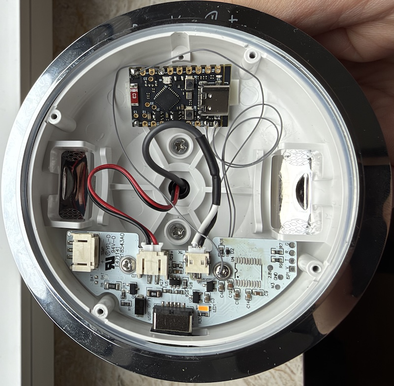
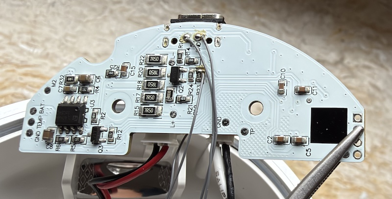
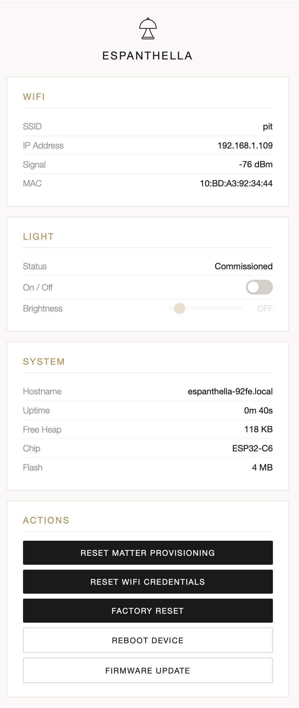

<p align="center">
  
</p>

<h1 align="center">espANTHELLA</h1>

<p align="center">
  <strong>A classic silhouette. A connected light.</strong><br>
  DIY Matter firmware for the Louis Poulsen Panthella 160 Portable.
</p>

<p align="center">
  <a href="https://platformio.org/"></a>
  
  <a href="https://github.com/espressif/esp-matter"></a>
  
</p>

<p align="center">
  <a href="#the-light">The light</a> &nbsp;·&nbsp;
  <a href="#getting-started">Getting started</a> &nbsp;·&nbsp;
  <a href="#hardware-modification">Hardware modification</a> &nbsp;·&nbsp;
  <a href="#web-dashboard">Dashboard</a>
</p>

---

## The light

**espANTHELLA** brings local smart-home control to a **Louis Poulsen Panthella 160 Portable**, the most beautiful and classic lamp. It's using a cheap ESP32-C6 and reuses the lamp's LED driver. It exposes a Matter dimmable light: switch it on, adjust the brightness, and include it in scenes and automations from your preferred Matter ecosystem.

Built with the Arduino-ESP32 Matter library on top of [Espressif's ESP-Matter](https://github.com/espressif/esp-matter), it combines smart-home integration with a small, self-contained web dashboard. **No cloud service is required**.

- **Matter on/off and dimming** over Wi-Fi, works with Ikea, Alexa, Google, etc.
- **Smooth light output** with a compile-time gamma curve, 10-bit PWM, and short hardware fades.
- **Local controls** through touch-dimming in 3 levels.
- **Browser control** with an on/off switch and brightness slider, synchronized with external changes.
- **Wi-Fi setup portal** no network credentials compiled into the firmware.
- **Optional WW/CW tunable white** using two PWM outputs and a Matter color-temperature light endpoint; the default single-channel build remains a dimmable light.
- **Persistent brightness and color temperature** (on WW/CW builds); the light always powers up on, regardless of its previous on/off state.
- **Maintenance tools** for pairing, resets, and firmware uploads.

> [!IMPORTANT]
> This project involves modifying the hardware of the original expensive lamp. Your warranty will definitely void. However, as restoring the original only requires soldering, I wouldn't call it a destructive modification.

> [!NOTE]
> This is an independent DIY modification, not an official Louis Poulsen product or a claim of Matter certification. Hardware revisions can differ; the firmware alone does not make a stock lamp compatible.

### Smart-home compatibility

| Platform | Status |
| --- | --- |
| **ESP32-C6 SuperMini** | Tested hardware target; current default build. |
| **IKEA DIRIGERA** | Tested pairing with the IKEA Home smart ecosystem. |
| **Amazon Alexa** | Expected to work through a compatible Matter controller; not separately verified here. |
| **Apple Home / Google Home / other Matter controllers** | Expected to work with Matter dimmable-light support; controller-specific commissioning requirements apply. |

The tested IKEA hub is **DIRIGERA**, not the older **TRÅDFRI gateway**, which does not support direct Matter device pairing. See [IKEA's gateway and app support](https://www.ikea.com/jp/en/customer-service/product-support/app-gateway/).

This firmware uses **Matter over Wi-Fi**, not Zigbee or Matter over Thread. The C6's radio capabilities do not change the transport selected by this project. Use a 2.4 GHz Wi-Fi network; a Thread border router is not required for this firmware. Voice assistants may require their own account, hub, or cloud services.

## Getting started

### Requirements

- An **ESP32-C6 SuperMini** with 4 MB flash and a USB data cable.
- **[PlatformIO](https://platformio.org/install)**—either PlatformIO IDE for VS Code or PlatformIO Core (`pio`).
- A 2.4 GHz Wi-Fi network.
- A Matter controller for smart-home pairing, or a browser for standalone local control.
- For the lamp retrofit: appropriate tools, a verified power supply, and an interface suitable for the lamp's LED driver.

The repository includes its custom [ESP32-C6 board definition](boards/esp32-c6-supermini.json). Build settings live in [platformio.ini](platformio.ini); GPIO assignments and dimming parameters live in [include/config.h](include/config.h).

### 1 · Build and flash over USB

Open this repository in PlatformIO, connect the board, and run these commands from the project root:

```sh
# Compile the default ESP32-C6 environment.
pio run -e default

# Build/upload the LittleFS web assets, then upload the firmware.
pio run -e default -t upload

# Open the serial monitor.
pio device monitor -b 115200
```

The upload hook automatically handles the LittleFS image containing the dashboard, setup pages, styles, and QR-code library. If port detection is ambiguous, use `pio device list` and configure the serial port in PlatformIO.

> [!TIP]
> Keep USB recovery accessible while developing the retrofit. GPIO12 and GPIO13 are USB D− and D+ on the C6: reconfiguring either as a general-purpose output can make the USB serial port disappear.

### 2 · Connect to Wi-Fi

1. On first boot, join the device's **`espANTHELLA-XXXX`** Wi-Fi access point. The suffix is generated from the device MAC address.
2. Open **http://192.168.4.1/** if the captive portal does not appear automatically.
3. Select your Wi-Fi network, or enter its SSID manually, and save the password.
4. The device saves the credentials and reboots onto your network.
5. Open **`http://espanthella-xxxx.local/`**, using your device's suffix, or the IP address printed on the serial monitor.

The setup AP is open by default. Provision the device in a trusted environment. If saved credentials fail, the firmware returns to setup mode.

### 3 · Pair with Matter

Open the dashboard while the device is uncommissioned. In your Matter controller's app, add a device and scan the displayed **QR code**, or enter the **manual pairing code**. The manual code is also printed to serial.

The usual 11-digit setup code is displayed as **`XXXX-XXX-XXXX`**; ignore the
dashes when entering it. Formatting preserves the original digits and check digit.
The QR code is generated locally from the decoded **`MT:...`** Matter payload,
not from the library's QR-generator URL or its percent-encoded `data` parameter.
It uses black modules on white with a scanner quiet zone. If the payload or QR
renderer is unavailable, the page shows a message directing you to the setup code.

After commissioning, the lamp appears as a dimmable light. Keep the controller and device on a network that allows local discovery and IPv6 traffic; guest/client isolation can prevent pairing or control.

## Hardware modification

### ESP32-C6 SuperMini pin assignment

These are **GPIO numbers**, not connector positions. The current assignments are defined in [include/config.h](include/config.h).

| Signal | C6 GPIO / connection | Purpose |
| --- | --- | --- |
| `PIN_PWM` | **GPIO7** | 3.3 V PWM control signal to a suitable LED-driver interface. |
| `PIN_BUTTON` | **GPIO9** | Onboard BOOT button, active low. |
| `PIN_TOUCH` | **GPIO4 / ADC1_CH4** | Experimental ADC-based touch-pad sensing. |
| Ground | **GND** | Common reference with the lamp's low-voltage control circuit. |
| Board power | Appropriate **5V/VBUS** or regulated **3V3** input | Verify the exact board revision and supply arrangement before connecting. |
| USB | **GPIO12 / GPIO13** | Reserved for USB D− / D+ while USB is in use. |
| Optional RGB debug output | **GPIO8** on the selected board variant | Keep separate from the PWM output. |

**Board reference:** [ESP32-C6 SuperMini high-resolution pinout, datasheet, schematic and specifications — Mischianti](https://mischianti.org/esp32-c6-supermini-high-resolution-pinout-datasheet-schema-and-specs/).

GPIO8 is also assigned to the RGB LED by the generic C6 variant. Enabling the optional `RGB_VERBOSE` code while using GPIO8 for PWM would let the RGB/RMT driver take over the PWM pin. The current PWM assignment uses GPIO7 to avoid that conflict.

GPIO4 and GPIO9 have boot-strapping functions on the C6. External circuits must not force an unsuitable level during reset. GPIO9 held low at reset can enter the ROM download mode rather than start the application.

### Steps to retrofit the Panthella 160 Portable

##### Disassembly
- Open the device, there are four screws below the rubber that you can lift with a thin piece of metal or a knife
- Remove the battery, it's not glued and has a JST-style connector
- Unplug the cables for LED and touch sensor
- Unscrew two screws to remove the PCB. Be careful not to lose the gaskets for the USB-C port.
##### Modification
- If you use a cheap ESP32-C6 super micro board, remove the charhing LED *and* the RGB LED (it consumes power even when off) and the battery charger chip. This works nicely with solder pliers or hot air.
- On the *Panthella PCB*, unsolder the microcontroller (U4). Use hot air at 450°C and flux, it will take ~3-5 sec.

##### Connections

Use **four thin wires**, approximately **5 cm** long, to connect the Panthella PCB to the ESP32-C6 SuperMini:

| Signal | Panthella PCB side | Panthella solder point | ESP32-C6 SuperMini connection |
| --- | --- | --- | --- |
| **Ground** | Bottom | Pad marked **GND** | **GND** |
| **Power** | Bottom | Pad marked **+5V** | **5V** |
| **PWM dimming** | Bottom | **R23**, right-hand pad (towards the USB-C port) | **GPIO7** (`PIN_PWM`) |
| **Touch** | Top | Touch sensor connector, left-hand pin (towards the USB-C port) | **GPIO4** (`PIN_TOUCH`) |

GPIO numbers match to the physical header positions and text on the ESP32-C6 PCB.

##### Mount
- Using two ~ 5x5mm thick double sided adhesive tape, stick the ESP32-C6 PCB to the available pads

##### Final Result

| Top view | Bottom view |
| :---: | :---: |
|  |  |

### Touch sensing on the ESP32-C6

The ESP32-C6 has **no native capacitive-touch peripheral**. The current fallback charges GPIO4, releases it to an input, and samples it with the ADC. It calibrates at startup and uses the measured value for brightness-step detection.

This is **experimental**, not equivalent to a dedicated touch controller. Pad geometry, leakage, ADC behavior, grounding, and the lamp enclosure can change the readings and even their direction. The current C6 detection condition checks for a drop below its derived threshold; validate actual untouched/touched readings before tuning. Keep the pad untouched during calibration. Samples, delay, and threshold multiplier are configured in [include/config.h](include/config.h).

Native-touch targets use the separate `SOC_TOUCH_SENSOR_SUPPORTED` path. Their thresholds are chip-specific and should not be reused blindly.

## Web dashboard

The dashboard follows the lamp's understated character: a small line-drawn lamp icon, warm brass accents, and simple sections. The README reuses that SVG icon; GitHub supplies its own typography and colors, so the dashboard's CSS is not embedded here.

<p align="center">
  
</p>

| Section | What it provides |
| --- | --- |
| **WiFi** | Network name, IP address, RSSI, and MAC address. |
| **Light** | Matter commissioning status, on/off control, and a brightness slider. |
| **PWM outputs (WW/CW builds)** | Swap the cool and warm PWM destinations without changing Matter temperature. |
| **WiFi antenna (XIAO ESP32C6)** | Switch between the internal ceramic and external antenna. |
| **Pair this device** | QR code and manual code before commissioning. |
| **System** | Hostname, uptime, free heap, chip model, and flash size. |
| **Actions** | Matter reset, Wi-Fi reset, factory reset, reboot, and firmware upload. |

The light controls poll for external state changes every three seconds, so changes made through Matter or local controls are reflected in the browser. The page and its QR-code library are served locally from LittleFS. See the [dashboard template](data/status.html) and [shared stylesheet](data/style.css).

> [!IMPORTANT]
> The HTTP dashboard, control API, and upload endpoint currently have **no authentication or TLS**. Keep them on a trusted LAN; do not expose them to the internet or forward their port. Matter's security does not protect these separate HTTP endpoints.

## Local controls and resets

| Action | Result |
| --- | --- |
| BOOT button click during normal operation | Toggle the light. |
| BOOT button long hold during normal operation | Decommission Matter and turn the light off. |
| Recognized touch | Advance through four brightness steps, including off. |
| Dashboard → Reset Matter Provisioning | Remove Matter provisioning so the device can be paired again. |
| Dashboard → Reset WiFi Credentials | Erase Wi-Fi credentials and reboot into setup mode. |
| Dashboard → Factory Reset | Erase Matter provisioning, Wi-Fi credentials, saved light state, and (on XIAO) antenna selection. |

The startup code also checks for a held button to reset Wi-Fi credentials. On the C6, holding BOOT through reset can instead select ROM download mode; use the dashboard reset when available.

## Firmware updates

### USB: the baseline update path

```sh
pio run -e default -t upload
```

This updates both the web assets and firmware through the existing upload hook.

### HTTP OTA tooling

The firmware includes an `/update` page, a combined firmware/filesystem format, and a PlatformIO OTA upload environment.

> [!WARNING]
> The current [4 MB partition table](partitions_4MB.csv) defines **only one application slot**. Standard Arduino `Update` firmware OTA requires an alternate OTA application partition; the single-slot layout is not a supported in-place update mechanism. Use USB with the current layout. Before relying on HTTP OTA, provide and validate an OTA-capable partition layout with enough space for this Matter firmware. Changing the partition table itself requires serial flashing.

With a suitable partition layout installed, the available tooling is:

```sh
# Rebuild web assets explicitly so the combined image includes current files.
pio run -e default -t buildfs

# Build a browser-uploadable firmware + filesystem bundle at ./combined.bin.
pio run -e default -t combined

# Or upload through PlatformIO; replace the address with your device IP.
pio run -e ota -t upload --upload-port 192.168.1.123
```

Upload `combined.bin` through **Dashboard → Firmware Update** to include both firmware and web assets. The endpoint also accepts plain firmware images, which leave the filesystem unchanged. These are application updates, not full-flash recovery images. Avoid interrupting power during an update.

## Development

### Single-channel and WW/CW hardware

The default environment keeps the existing hardware and Matter device type:
`MatterDimmableLight`, with GPIO7 driving the single-channel LED-driver input.
The optional `tunable` environment uses `MatterColorTemperatureLight` instead,
with `PIN_PWM` driving **WW** and a separately assigned GPIO driving **CW**.
Both variants share the state, gamma correction, PWM, touch, and persistence code.

**The generic `tunable` environment does not select a CW GPIO automatically.** Verify a free output-capable pin on
your exact board and circuit, then add `-DLIGHT_CW_PIN=<GPIO number>` to the
`tunable` environment's `build_flags` in [platformio.ini](platformio.ini).
The tunable build deliberately fails until this is assigned. Do not use GPIO12/13
(USB on C6), the touch/button pins, or a pin occupied by another peripheral.
Use suitable independently controlled LED drivers, not LEDs directly on GPIOs.
Two-wire polarity-reversing tunable LEDs require a different driver interface.

After assigning the pin:

```sh
pio run -e tunable
pio run -e tunable -t upload
```

Always select the matching hardware environment when building firmware. The
`ota` environment inherits the XIAO ESP32C6 WW/CW configuration; do not use that
image on single-channel hardware. The partition-table/OTA limitations described
above still apply.

Temperature settings in [include/config.h](include/config.h) can also be
customized with build flags:

| Setting | Default | Meaning |
| --- | --- | --- |
| `LIGHT_TUNABLE_WHITE` | `0` (`1` in `tunable`) | Compile-time hardware and Matter endpoint selection. |
| `LIGHT_WW_PIN` | Board default | Single-channel or WW output GPIO. |
| `LIGHT_CW_PIN` | Unassigned | Required CW output GPIO for WW/CW hardware. |
| `LIGHT_TOUCH_ENABLED` | `1` | Set to `0` to compile out touch calibration and sensing. |
| `LIGHT_WARM_KELVIN` | `2700` | Rated WW endpoint. |
| `LIGHT_COOL_KELVIN` | `6500` | Rated CW endpoint. |
| `LIGHT_DEFAULT_KELVIN` | Warm endpoint | Temperature used when no saved setting exists. |

The installed Arduino endpoint supports **2000–10000 K**; the firmware rejects
configurations outside that range. It sets Matter's physical temperature limits
to the configured LED endpoints before starting the stack. Matter and the HTTP
API use integer **mireds** (`1,000,000 / Kelvin`), so the dashboard's Kelvin labels
may differ slightly from the nominal LED ratings after conversion.

At a given brightness, the firmware gamma-corrects the total PWM duty, then
splits it between WW and CW linearly in mireds. The target duties sum to the same
total across the temperature range; the midpoint does not drive both outputs at
full duty. This is an approximate mix, not photometric/colorimetric calibration.
Different channel efficacy can still change perceived brightness.

Temperature can be changed while off without turning on either output. Touch
continues to cycle brightness only; it preserves the selected temperature. The
dashboard shows temperature control only on the WW/CW build. **WW/CW hardware
operation and controller interoperability still need testing on the actual lamp.**

Keep the selected hardware mode stable once commissioned. If an existing device
is changed from single-channel to WW/CW (or back), remove it from the Matter
controller, reset Matter provisioning, and pair it again; controllers may cache
the endpoint type and capabilities. The existing brightness preference remains
compatible; any old on/off preference is ignored and never written again.

### Seeed Studio XIAO ESP32C6 WW/CW build

The separate `seeed_xiao_esp32c6` environment selects the XIAO board and
configures two adjacent header pins using the Arduino board aliases
`LIGHT_WW_PIN=D8` and `LIGHT_CW_PIN=D9`:

| Output | Header label | GPIO |
| --- | --- | --- |
| WW PWM | **D8** | **19** |
| CW PWM | **D9** | **20** |

These are also the board's SPI SCK/MISO pins; do not use SPI on them at the same
time. They avoid USB, the BOOT button, the onboard LED, and antenna-control pins.

Only the XIAO ESP32C6 build has an **External antenna** switch on the setup portal
and dashboard. Off uses the internal ceramic antenna (the default); attach an
external antenna before switching it on. The selection is saved independently of WiFi
credentials and restored before the WiFi station or setup AP starts. The board's
RF switch is enabled with GPIO3 LOW; GPIO14 LOW selects internal and HIGH selects
external. Saving a new selection may briefly interrupt the portal connection.
WiFi reset keeps the choice; factory reset restores the internal default.

The dashboard's **Swap CW and WW** switch exchanges the duties sent to WW
(D8/GPIO19) and CW (D9/GPIO20) when the drivers are wired in reverse. It takes
effect after saving, is restored on reboot, and is cleared by factory reset.
The Matter temperature range and its values do not change. Single-channel
builds hide the control and reject the setting.

The environment sets `LIGHT_TOUCH_ENABLED=0`, excluding both startup calibration
and runtime touch sensing, with no access to the unused touch pin. The BOOT
button remains available for the normal button controls.

```sh
pio run -e seeed_xiao_esp32c6
pio run -e seeed_xiao_esp32c6 -t upload
```

### Light HTTP API

`GET /api/light` returns, for example on a WW/CW build:

```json
{"on":true,"brightness":128,"supportsColorTemperature":true,"temperature":250,"minTemperature":153,"maxTemperature":370}
```

`POST /api/light` accepts URL-encoded partial updates:

- `on=0` or `on=1`.
- `brightness=0..255`. Zero turns off and retains the previous nonzero brightness;
  nonzero values update the stored level, including while off. Send `on=1` too
  when a brightness change should turn the light on.
- `temperature=<positive integer mireds>` on WW/CW builds, clamped to the physical
  range without changing the on/off state. Single-channel builds reject it.

Brightness uses the UI scale 0–255; the light API maps nonzero values to Matter's
valid CurrentLevel range 1–254. The temperature capability flag is authoritative;
temperature fields are not adjustable on a single-channel build. Invalid requests
return HTTP 400 before applying any fields.

The lamp **always powers up on** with the last stored brightness and, on WW/CW
builds, color temperature. If stored brightness is zero, it starts at **20%**
(51/255). On/off remains controllable via Matter, web, and local button while
running, but is never read from or written to application preferences. Output
is restored before WiFi provisioning, including when the setup portal blocks
startup. Before Matter server-ready, callbacks cannot change the lamp and
premature controller writes are rejected. Once ready, the on state and restored
brightness/temperature are published to Matter and its endpoint cache is aligned.
Failed publication is retried while the output remains stable. A secure-session
event re-reports current values without replaying boot state. Brightness and
temperature changes are saved from the main loop on its next pass, writing only
changed keys; failed writes are retried. Matter callbacks do not write flash.
Intentional web reboots/updates also flush state. Power loss before the next loop pass or during
an NVS write can still lose the latest adjustment. Frequent dimming changes
increase flash wear compared with the former one-second debounce. Factory reset
prevents cleared preferences from being repopulated.

### Dimming configuration

The defaults in [include/config.h](include/config.h) are:

| Setting | Default |
| --- | --- |
| PWM frequency | 14,550 Hz |
| PWM resolution | 10 bit, duty 0–1023 |
| Gamma exponent | 1.9 |
| Fade duration | 20 ms |
| Local brightness steps | 4, including off |

UI brightness is represented as 0–255 and mapped through the gamma lookup table to the PWM duty; Matter's nonzero 1–254 levels are scaled to this range. To inspect the actual table generated from the project source:

```sh
pio run -e default -t printgamma
```

This diagnostic target also requires a host C++ compiler available as `g++`. Explicitly selecting `default` matters: the OTA environment does not register this target.

### Regression tests

Run the dependency-free host suites without an ESP32 connected:

```sh
python3 scripts/test_light_host.py
python3 scripts/test_light_host.py --board xiao --mode 1
c++ -std=c++20 -DARDUINO_XIAO_ESP32C6 -Itest/host/support -Iinclude \
  src/antenna.cpp test/host/antenna_test.cpp -o /tmp/espanthella-antenna-test
/tmp/espanthella-antenna-test
node test/dashboard.test.cjs
```

The C++ suite requires Python 3.8+ and a C++20 compiler. It compiles the actual
light module in both hardware modes against small Arduino/Matter/LEDC test
stubs, and checks mixing, brightness conversion, callback queuing, restored state,
immediate change persistence, resets, driver errors, and configuration guards. These are
logic tests, not a substitute for the real Matter stack and LED-driver hardware.
The suites also check URL-decoding and validation of Matter QR payloads, dashed
manual setup codes (including leading zeroes), and QR-renderer error handling.
The antenna host test checks the XIAO GPIO sequence, persistence, deferred
switching, and factory reset. The Node suite exercises the dashboard's actual
inline controller, including capability visibility, Kelvin conversion,
off-state temperature changes, and serialized requests/stale-response protection.

### Project map

| Location | Contents |
| --- | --- |
| [src/light.cpp](src/light.cpp) | Private Matter endpoint, shared light state, gamma table, LEDC outputs, immediate main-loop persistence, and touch handling. |
| [include/light.h](include/light.h) | Hardware-independent API used by the button, touch, and web controls. |
| [include/light_math.h](include/light_math.h) | Host-testable brightness conversion and constant-sum WW/CW mixing. |
| [src/antenna.cpp](src/antenna.cpp) | XIAO ESP32C6 RF-switch configuration and saved antenna selection. |
| [src/wifi_portal.cpp](src/wifi_portal.cpp) | Wi-Fi connection, credential storage, and captive portal. |
| [src/web_mgmt.cpp](src/web_mgmt.cpp) | Dashboard, light-control API, resets, and HTTP updates. |
| [data/](data/) | Locally served HTML, CSS, JavaScript, and SVG icon. |
| [scripts/](scripts/) | Filesystem deployment, image packaging, and build diagnostics. |
| [boards/](boards/) | Custom PlatformIO board definitions. |

---

<p align="center">
  <br>
  <sub>Independent firmware for a well-loved light.<br>
  Louis Poulsen, Panthella, IKEA, and the smart-home platform names belong to their respective owners.</sub>
</p>
